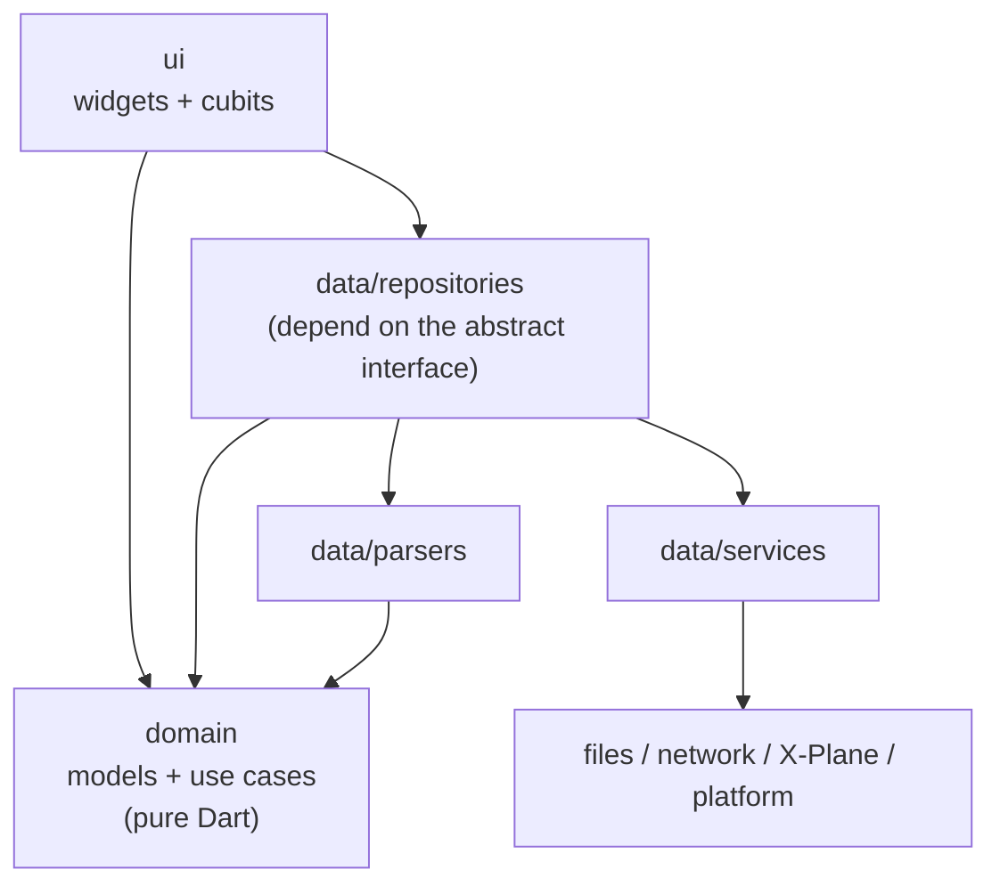
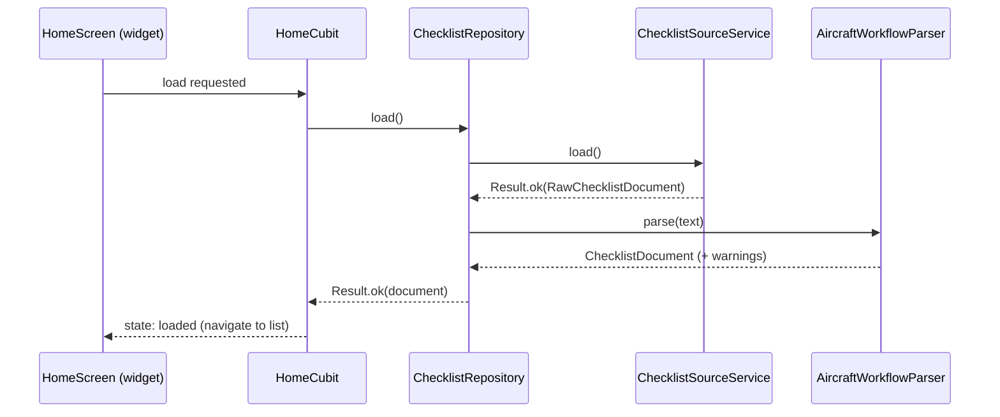
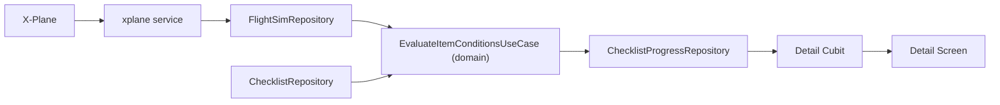

# Architecture and Folder Layout

FlightSim Aide is a Flutter app that works like XChecklist for X-Plane. This document defines the architecture and package structure for the **whole project**, so the layout does not need to change as features are added.

Folders marked `[placeholder]` in the tree exist with a `README.md` but hold no code yet.

---

## 1. Table of contents

1. [Approach and sources](#2-approach-and-sources)
2. [Layers and dependency rules](#3-layers-and-dependency-rules)
3. [Compass to Bloc/Cubit mapping](#4-compass-to-bloccubit-mapping)
4. [Full folder layout](#5-full-folder-layout)
5. [Layer responsibilities](#6-layer-responsibilities)
6. [The checklist source seam](#7-the-checklist-source-seam)
7. [Dependency injection and entry points](#8-dependency-injection-and-entry-points)
8. [Key interfaces (sketches)](#9-key-interfaces-sketches)
9. [Data flow examples](#10-data-flow-examples)
10. [Where new code goes (so the layout stays fixed)](#11-where-new-code-goes-so-the-layout-stays-fixed)
11. [Testing layout](#12-testing-layout)
12. [Naming conventions](#13-naming-conventions)
13. [Packages](#14-packages)
14. [Open decisions](#15-open-decisions)
15. [Companion plugin and network transport](#16-companion-plugin-and-network-transport)
16. [Live checklist data and auto-check](#17-live-checklist-data-and-auto-check)

---

## 2. Approach and sources

This follows the structure of the Flutter team's **Compass app** architecture case study (docs.flutter.dev/app-architecture/case-study), which most resembles MVVM.

**Confirmed from the case study**
- Most code lives in three folders, `data`, `domain` and `ui`, plus a `config` folder.
- The `ui` folder is organized **by feature**.
- The `domain` folder holds the application data types, because both the data and UI layers use them.
- The data layer uses **repositories** and **services**. Repositories turn raw service data into domain models. Compass also has environment variants of repositories, such as a `Local` version for development.
- The `test` folder structure mirrors `lib`.
- The Compass guidelines recommend separate API models and domain models, immutable data, and unidirectional data flow.

**Written from memory, not re-checked**
Exact sub-folder names (for example `view_models/`, `widgets/`, `ui/core/`, `routing/`, `utils/`, `config/dependencies.dart`, and a root `testing/` folder with fakes). Before creating folders, compare against the Compass source on GitHub (`flutter/samples`, `compass_app`) and adjust names if they differ.

**Deliberate departures from Compass**
1. **Bloc/Cubit instead of `provider` + ViewModel.** A Cubit plays the ViewModel role.
2. **State classes instead of the Command pattern.** Compass uses Commands to render async state safely. With Bloc, a state class (loading, loaded, error) does that job.
3. **One repository implementation with a swappable source service**, instead of separate `_local` and `_remote` repositories for the checklist. Reason: the checklist text format and parsing are identical whether the file comes from disk or the network. Only the transport changes, so only the service is swapped (see section 7). Compass's `_local`/`_remote` naming is still used where behavior genuinely differs, such as the X-Plane repository.
4. **A `parsers/` folder in the data layer**, which Compass does not have. It holds the aircraft workflow parser (`AircraftWorkflowParser`, XChecklist syntax), shared by every source.

### Simulator support

X-Plane is the only simulator supported today, but FlightSim Aide is not limited to it. The design can support other flight simulators (for example MSFS 2020 and 2024) by adding a companion for that simulator that speaks the same simulator-neutral protocol (section 16), and a way to discover it. `domain/` and `ui/` never name a simulator, except where the user is told which ones are supported; that list lives in one place (`supportedSimulators`). A simulator is identified by how it announces itself: a beacon arriving on X-Plane's multicast group and port is taken to come from X-Plane, and the plugin's `GET /v1/hello` (`sim.kind`) confirms it. A new simulator brings its own discovery source and is not assumed to use X-Plane's beacon.

---

## 3. Layers and dependency rules



**Rules (enforce in code review, optionally with an import lint)**

| Layer | May import | Must not import |
|---|---|---|
| `domain` | Dart core only | Flutter, Bloc, anything in `data` or `ui` |
| `data` | `domain`, `utils` | `ui`, Flutter widgets, Bloc |
| `ui` | `domain`, `data/repositories` (abstract interfaces only), `utils`, `routing` | `data/services`, `data/parsers`, any concrete repository class |
| `config` | everything | (it is the composition root, the only place concrete classes are wired together) |

**Data flows one way:** data layer to UI layer. User actions go from widget to Cubit to repository or use case, and results come back as new state. Domain models are **immutable**.

**Where logic lives**

| Kind of logic | Home |
|---|---|
| Business rules (progress counting, toggling, auto-check evaluation) | `domain` |
| File-format knowledge (XChecklist text syntax) | `data/parsers` |
| Transport (disk, HTTP, socket) | `data/services` |
| Orchestration and caching of data | `data/repositories` |
| Screen state and UI logic only | `ui/<feature>/cubit` |

---

## 4. Compass to Bloc/Cubit mapping

| Compass concept | This project |
|---|---|
| ViewModel (`ui/<feature>/view_models/`) | Cubit and its state (`ui/<feature>/cubit/`) |
| `ChangeNotifier` + `ListenableBuilder` | `BlocBuilder` / `BlocListener` / `BlocSelector` |
| Command objects (running, error, result) | Sealed or status-based state classes |
| `provider` for dependency injection | `RepositoryProvider` / `MultiRepositoryProvider` from `flutter_bloc` |
| `Result<T>` in `utils/` | Same, kept for repository and service return values |
| `config/dependencies.dart` with local and remote provider lists | Same idea, with Bloc-flavored providers |
| Repositories and services | Same |
| Optional domain use cases | Same, used only where logic spans several repositories (auto-check was the first) |

---

## 5. Full folder layout

```
lib/
├── main.dart                               # production entry point
├── app.dart                                # MaterialApp.router, theme, top-level providers
│
├── config/
│   ├── dependencies.dart                   # shared wiring helpers
│   ├── network_link.dart                   # the discovery, session and stream objects shared by the providers
│   └── dependencies_production.dart        # wires the network source and the real X-Plane connection
│
├── routing/
│   ├── routes.dart                         # route name/path constants
│   └── router.dart                         # route table (go_router)
│
├── utils/
│   ├── result.dart                         # Result<T> (ok / error)
│   ├── app_exception.dart                  # typed failures (ParseFailure, SourceCancelled, ...)
│   └── text_decoding.dart                  # bytes -> text: strict UTF-8, Latin-1 fallback (pure Dart)
│
├── domain/                                 # pure Dart, no Flutter or Bloc imports
│   ├── models/
│   │   ├── checklist/
│   │   │   ├── checklist_document.dart     # checklists + parse warnings + sourceName (file name, for display)
│   │   │   ├── checklist.dart
│   │   │   ├── checklist_item.dart         # check item or note
│   │   │   ├── lookup_table.dart           # sw_table: input columns (dataref or expression), output columns, rows (D-83)
│   │   │   ├── calculate_line.dart         # sw_calculate: one table value shown under an item (D-83)
│   │   │   └── checklist_progress.dart     # immutable check state + toggle/reset/count logic
│   │   ├── aircraft/
│   │   │   └── aircraft_identity.dart      # ICAO, description, aircraft path, checklist modified time
│   │   ├── flight_sim/                         # connection status, dataref values, conditions
│   │   │   ├── dataref.dart
│   │   │   ├── dataref_value.dart
│   │   │   ├── item_condition.dart
│   │   │   └── connection_status.dart
│   │   └── voice/                          # [placeholder]
│   │       └── voice_settings.dart
│   └── use_cases/
│       ├── autocheck/                      # placeholder
│       │   └── evaluate_item_conditions_use_case.dart
│       └── voice/                          # [placeholder]
│           └── announce_next_item_use_case.dart
│
├── data/
│   ├── repositories/
│   │   ├── checklist/
│   │   │   ├── checklist_repository.dart                   # abstract
│   │   │   ├── checklist_repository_impl.dart              # source + parser -> domain models
│   │   │   ├── checklist_progress_repository.dart          # abstract (holds check state; toggle, reset, resetAll)
│   │   │   └── checklist_progress_repository_impl.dart     # persisted per aircraft
│   │   ├── flight_sim/                         # connection, plugin discovery and the dataref stream
│   │   │   ├── flight_sim_repository.dart                      # abstract: connection + dataref stream + set
│   │   │   ├── flight_sim_repository_remote.dart               # the real connection
│   │   │   └── flight_sim_repository_local.dart                # scriptable fake for tests
│   │   ├── voice/                          # [placeholder]
│   │   │   ├── voice_repository.dart
│   │   │   └── voice_repository_impl.dart
│   │   └── settings/                       # (manual sim IP, preferences)
│   │       ├── settings_repository.dart
│   │       └── settings_repository_impl.dart
│   │
│   ├── parsers/
│   │   └── aircraft_workflow_parser.dart     # text -> domain models (pure function, shared by all sources)
│   │
│   └── services/
│       ├── checklist/
│       │   ├── checklist_source_service.dart               # abstract: "give me the raw checklist text"
│       │   ├── network_checklist_source_service.dart       # HTTP source via the companion plugin
│       │   └── model/
│       │       └── raw_checklist_document.dart             # raw text + display name
│       ├── flight_sim/                         # beacon, plugin discovery, datarefs
│       │   ├── flight_sim_service.dart                         # abstract transport
│       │   ├── flight_sim_connection_service.dart              # X-Plane beacon, handshake, WebSocket stream
│       │   ├── companion_plugin_service.dart               # HTTP: GET /v1/aircraft
│       │   └── model/
│       │       └── raw_dataref_message.dart
│       ├── voice/                          # [placeholder]
│       │   └── speech_service.dart
│       ├── local/                          # shared_preferences and similar; checklist cache
│       │   ├── preferences_service.dart
│       │   ├── checklist_cache_service.dart                # raw checklist text + file mtime/size, keyed by aircraft path
│       │   └── progress_storage_service.dart               # saved check state + last viewed checklist, keyed by aircraft path
│
└── ui/
    ├── core/
    │   ├── themes/
    │   │   └── app_theme.dart              # light and dark (dark matters for night flying)
    │   ├── localization/                   # [placeholder]
    │   └── widgets/                        # shared widgets (error banner, loading indicator)
    │
    ├── home/
    │   ├── cubit/
    │   │   ├── home_cubit.dart
    │   │   └── home_state.dart
    │   └── widgets/
    │       └── home_screen.dart
    │
    ├── checklist_list/
    │   ├── cubit/
    │   │   ├── checklist_list_cubit.dart
    │   │   └── checklist_list_state.dart
    │   └── widgets/
    │       ├── checklist_list_screen.dart
    │       └── checklist_list_tile.dart
    │
    ├── checklist_detail/
    │   ├── cubit/
    │   │   ├── checklist_detail_cubit.dart
    │   │   └── checklist_detail_state.dart
    │   └── widgets/
    │       ├── checklist_detail_screen.dart
    │       └── checklist_item_tile.dart
    │
    ├── connection/                         # X-Plane connection status, manual IP entry, "plugin not detected"
    │   ├── cubit/
    │   └── widgets/
    │
    └── settings/                           # manual sim IP, appearance, options
        ├── cubit/
        └── widgets/

test/                                       # mirrors lib/
├── data/
│   ├── parsers/
│   │   └── aircraft_workflow_parser_test.dart
│   └── repositories/
├── config/                                     # wiring tests
├── domain/
│   └── models/
│       └── checklist_progress_test.dart
├── routing/
├── utils/
└── ui/
    ├── core/
    ├── home/
    ├── checklist_list/
    └── checklist_detail/

testing/                                    # shared test helpers (not tests themselves)
├── fakes/
│   ├── repositories/                       # fake ChecklistRepository etc.
│   └── services/                           # fake ChecklistSourceService
└── fixtures/
    ├── minimal.txt
    ├── messy.txt
    └── lookalike_aircraft.txt              # hand-written, license-free; parser-level tests

assets/
└── branding/                               # app icon sources

Documentation/                              # architecture, plan, reference (grammar, checklist guide), testing records (acceptance, manual tests, real checker), decisions, TODO
external/                                   # git-ignored downloads (X-Plane SDK, Xchecklist source); see BUILDING.md
tools/                                      # env_* scripts, verify.sh and the check_* gate scripts (structure, layers, isolation, fixtures, coverage, acceptance tags)
plugin/                                     # companion X-Plane plugin: C++ (XPLM SDK, CivetWeb), CMake, per-OS build notes (section 16)
```

---

## 6. Layer responsibilities

### `domain`
- Immutable models: `Checklist`, `ChecklistItem`, `ChecklistDocument`, `ChecklistProgress`. A `ChecklistDocument` also holds its `LookupTable`s (`sw_table`, never shown) and a `ChecklistItem` its `CalculateLine`s (`sw_calculate`): the data and the references only; the lookup against live values comes with D-83's next steps.
- Colour and flow data live in the same models: items carry ordered colour runs (colour names only, no Flutter `Color`), the document carries the `sw_define_colour` palette, and each checklist carries its `sw_continue` links (an ordered list). File order is not flight order; a pure helper follows the continue links to give the sequence.
- `ChecklistProgress` owns the check-state rules (toggle, reset, counts, completion). Both manual taps and auto-check update the same model, so there is one set of rules. A switch (`sw_switch`, D-82) is a switch row plus blocks (`sw_if`, `sw_else`, `sw_end`) whose items point at it through `ChecklistItem.gate` (a `SwitchGate`: the `SwitchDef` with its id and default, and the position of the branch); `ChecklistProgress` keeps the positions that differ from the default by id for the whole file, hides the items of the branch that is not current, counts the switch rows and the shown items (`ChecklistItem.isCheckable`), and auto-check stops at a switch row like at a manual item.
- Use cases appear only when logic combines several data sources. The first real one is auto-check, which combines the checklist, the live X-Plane values and the current progress.
- No Flutter, Bloc, or `dart:io` imports.

### `data/repositories`
- The only things the UI talks to. Each exposes an abstract interface plus an implementation.
- `ChecklistRepository`: loads the document by asking a `ChecklistSourceService` for raw text, passing it through the parser, and caching the resulting `ChecklistDocument` (stamped with `sourceName`) so several screens can share it. A document with zero checklists is returned as `Error(ParseFailure)`, not as an empty success.
- `ChecklistProgressRepository`: holds the current `ChecklistProgress` and exposes it as a stream. Persisted per aircraft (section 16). `resetAll()` clears every checklist's marks; `HomeCubit` calls it after each successful load so marks from a previous file never leak into the next. Auto-check results are written here too.
- `FlightSimRepository`: exposes connection status and a stream of dataref values. `FlightSimRepositoryRemote` is the real connection; `FlightSimRepositoryLocal` is a scriptable fake for tests.
- Repositories return `Result<T>`, never throw to the UI.

### `data/parsers`
- `AircraftWorkflowParser`: a pure function from `String` to a domain `ChecklistDocument` plus warnings. No I/O. Used by the repository regardless of where the text came from.
- It parses colour markers, `sw_define_colour` and `sw_continue` into the model (showing colours is a UI task). `sw_show` is not supported: it warns and is skipped. Only `sw_rcolsize` is ignored silently.
- The parser fills an `ItemCondition` on each item and on each `sw_continue` link from the dataref portion of the line (`ConditionExpressionParser`).

### `data/services`
- Wrap one external thing each: a file, an HTTP endpoint, a socket, a platform plugin.
- Return raw data (for example `RawChecklistDocument`), never domain models.
- Contain no business rules.

### `ui`
- Organized by feature. Each feature has a `cubit/` folder (Cubit and state) and a `widgets/` folder (screen and feature-specific widgets).
- Cubits depend only on abstract repositories and use cases. They hold screen state, not business rules.
- `ui/core/` holds code shared by several features.
- The warnings banner (lines the parser skipped, with a Details view) lives on the checklist list screen, because a successful load navigates straight there.

---

## 7. The checklist source seam

The abstract `ChecklistSourceService` is the seam between where checklist text comes from and everything that uses it. Everything above it (repository, parser, domain, cubits) knows only that it can ask for raw checklist text. Today the one implementation is `NetworkChecklistSourceService`, which fetches the text from the companion plugin (section 16). A different source needs one new implementation and one wiring line in `config/`; the repository, the parser, the domain models and the list and detail features do not change.

**Design rules that keep the seam clean**
- `ChecklistSourceService` exposes a single method with no UI parameters: `Future<Result<RawChecklistDocument>> load()`.
- A source that can be cancelled returns a typed failure (`SourceCancelled`) that the Cubit treats as "nothing happened", not as an error.
- Decoding bytes to text (`utils/text_decoding.dart`) is shared by every source.
- No cubit, widget or repository imports `dart:io` or an HTTP client.

---

## 8. Dependency injection and entry points

**Composition root:** `config/`. It is the only place that names concrete classes.

- `main.dart` builds the app with `productionProviders()` from `dependencies_production.dart`. It needs no flag: it finds the sim from its beacon.
- A new environment (a demo, a test harness) adds `config/dependencies_<env>.dart` and `main_<env>.dart`.

**Sketch of the wiring**

```dart
// config/dependencies_production.dart (shape only)
List<RepositoryProvider> productionProviders() => [
  // --- services ---
  RepositoryProvider<ChecklistSourceService>(
    create: (_) => NetworkChecklistSourceService(/* plugin session, cache */),
  ),

  // --- repositories ---
  RepositoryProvider<ChecklistRepository>(
    create: (c) => ChecklistRepositoryImpl(
      source: c.read<ChecklistSourceService>(),
      parser: const AircraftWorkflowParser(),
    ),
  ),
  RepositoryProvider<ChecklistProgressRepository>(
    create: (c) => ChecklistProgressRepositoryImpl(/* progress storage */),
  ),
];
```

```dart
// app.dart
MultiRepositoryProvider(
  providers: productionProviders(),
  child: MaterialApp.router(routerConfig: router, theme: AppTheme.light, darkTheme: AppTheme.dark),
)
```

Each screen creates its Cubit from repositories in the route builder:

```dart
BlocProvider(
  create: (c) => ChecklistListCubit(
    checklistRepository: c.read<ChecklistRepository>(),
    progressRepository: c.read<ChecklistProgressRepository>(),
  )..load(),
  child: const ChecklistListScreen(),
)
```

---

## 9. Key interfaces (sketches)

These show the shape of the seams, not final code.

```dart
// data/services/checklist/checklist_source_service.dart
abstract class ChecklistSourceService {
  Future<Result<RawChecklistDocument>> load();
}

// data/services/checklist/model/raw_checklist_document.dart
class RawChecklistDocument {
  final String name;   // file or resource name, for display
  final String text;   // raw file contents
  const RawChecklistDocument({required this.name, required this.text});
}
```

```dart
// data/repositories/checklist/checklist_repository.dart
abstract class ChecklistRepository {
  /// Latest loaded document, or null before the first load.
  ChecklistDocument? get current;
  Stream<ChecklistDocument?> get changes;

  /// Fetches from the configured source, parses, caches, and publishes.
  Future<Result<ChecklistDocument>> load();
}

// data/repositories/checklist/checklist_progress_repository.dart
abstract class ChecklistProgressRepository {
  Stream<ChecklistProgress> get progress;
  ChecklistProgress get current;
  void toggle(String checklistName, int itemIndex);
  void reset(String checklistName);
  void resetAll();
}
```

```dart
// data/parsers/aircraft_workflow_parser.dart
class AircraftWorkflowParser {
  const AircraftWorkflowParser();
  ChecklistDocument parse(String text); // pure, no I/O
}
```

```dart
// domain/models/checklist/checklist_progress.dart  (immutable)
class ChecklistProgress {
  final Map<String, Set<int>> checked;
  const ChecklistProgress([this.checked = const {}]);

  ChecklistProgress toggled(String checklistName, int index);
  ChecklistProgress reset(String checklistName);
  ({int done, int total}) countsFor(Checklist checklist);
}
```

```dart
// data/repositories/flight_sim/flight_sim_repository.dart
abstract class FlightSimRepository {
  Stream<ConnectionStatus> get connectionStatus;
  Stream<DatarefValue> watch(Dataref dataref);
  Future<Result<void>> write(Dataref dataref, num value);
}
```

```dart
// example Cubit state (replaces Compass Commands)
sealed class ChecklistListState {}
class ChecklistListLoading extends ChecklistListState {}
class ChecklistListLoaded extends ChecklistListState {
  final List<ChecklistSummary> items; // title + done/total
}
class ChecklistListFailure extends ChecklistListState {
  final String message;
}
```

---

## 10. Data flow examples

### Load a checklist and check an item



Toggling an item: `ChecklistDetailScreen` calls `ChecklistDetailCubit.toggle(i)`, which calls `ChecklistProgressRepository.toggle(...)`. The repository emits a new immutable `ChecklistProgress`, the Cubit re-emits state, and the list screen's counts update through the same stream.

### Auto-check



Nothing in this flow requires new top-level folders. The use case goes in `domain/use_cases/autocheck/`, and the X-Plane repository and service folders are in place.

---

## 11. Where new code goes (so the layout stays fixed)

| You are adding... | Put it in |
|---|---|
| A new screen or feature | `ui/<feature>/cubit/` and `ui/<feature>/widgets/` (copy an existing feature) |
| A widget used by 2+ features | `ui/core/widgets/` |
| A new data capability (a new external system) | A repository (abstract + impl) in `data/repositories/<name>/` and a service in `data/services/<name>/` |
| A new domain concept | `domain/models/<area>/` |
| Logic combining several repositories | `domain/use_cases/<area>/` |
| A new rule about checking, progress or conditions | `domain/models/...` or a use case (never in a Cubit or widget) |
| A new file-format feature (new XChecklist keyword) | Parser, plus a field on the domain model if needed |
| A new environment (staging, demo) | `config/dependencies_<env>.dart` and `main_<env>.dart` |
| A new route | `routing/routes.dart` and `routing/router.dart` |
| Fakes for tests | `testing/fakes/` |

**Guidelines that prevent relayout**
- Placeholder folders (voice, localization) exist with a one-line `README.md` that starts `Status: placeholder`; `tools/check_structure.sh` checks them.
- Add fields and files to existing folders. Do not create new top-level folders under `lib/` without updating this document.
- If a feature folder grows large, add sub-folders inside `widgets/`. Do not restructure `cubit/`.

---

## 12. Testing layout

- `test/` mirrors `lib/`. `testing/` at the project root holds shared fakes and fixtures.
- **Parser tests** are pure Dart and use the fixture files. This is where most testing effort goes.
- **Domain tests** cover `ChecklistProgress` (toggle, reset, counts, completion).
- **Repository tests** use a fake `ChecklistSourceService` returning fixture text, so no network or file system is involved.
- **Cubit tests** (with `bloc_test`) use fake repositories and assert state sequences: loading, loaded, failure.
- **Widget tests** use fake repositories via `RepositoryProvider` overrides.

---

## 13. Naming conventions

| Thing | Convention | Example |
|---|---|---|
| Abstract repository | `<Name>Repository` | `ChecklistRepository` |
| Implementation | `<Name>RepositoryImpl`, or `_local` / `_remote` when behavior truly differs | `FlightSimRepositoryRemote` |
| Service | `<Thing>Service` | `ChecklistSourceService` |
| Raw (non-domain) model | `Raw<Thing>` in the service's `model/` folder | `RawChecklistDocument` |
| Cubit and state | `<Feature>Cubit`, `<Feature>State` | `ChecklistListCubit` |
| Screen widget | `<Feature>Screen` | `ChecklistDetailScreen` |
| Use case | `<Verb><Noun>UseCase` | `EvaluateItemConditionsUseCase` |

---

## 14. Packages

**Core**
- `flutter_bloc` (brings `bloc`)
- `equatable` for state and model equality (the one third-party package allowed inside `domain/`)
- `go_router` for routing
- Dev: `bloc_test`, `mocktail`, `flutter_lints`

**Network and storage**
- `http` for the companion plugin client; the stream and the beacon use `dart:io` (`WebSocket`, `RawDatagramSocket`), no package
- `shared_preferences` for settings; `path_provider` for the checklist cache and saved progress files (see section 16)
- Possibly a small plugin or platform channel for the Android multicast lock

**Not chosen yet**
- Voice: a text-to-speech package (and speech recognition if voice input is wanted)

---

## 15. Open decisions

None open. The earlier decisions are resolved: check-state persistence and Cubit-per-screen by the first version (`Documentation/Architecture/DECISIONS.md`), and the X-Plane transport, checklist serving and aircraft association by section 16.

---

## 16. Companion plugin and network transport

**Goal.** The phone finds a running X-Plane on the LAN, learns which aircraft is loaded, and fetches that aircraft's checklist text file. Live values come over the plugin's own stream protocol; the on-ground flag and the aircraft generation drive the restore rule, and the dataref names of the open checklist drive auto-check (section 17).

**Transport (D-36 to D-41 in `Documentation/Architecture/DECISIONS.md`).** Live data no longer uses X-Plane's native UDP `RREF`/`DREF`. The companion plugin owns the protocol: a handshake and a WebSocket stream on the same CivetWeb port as the HTTP API. The fake is the specification; the plugin core is tested without X-Plane. Consequence: the plugin is required for live data (no stock-sim fallback).

**Requirements.**
- R1. Know which aircraft is loaded.
- R2. Receive that aircraft's checklist text file.
- R3. Read (later write) simulator values at 30-60 Hz. The transport is the plugin's stream protocol (WebSocket, JSON); the app subscribes to the aircraft generation, the on-ground flag and the datarefs of the open checklist.
- R4. Find the sim without typing an IP (manual IP is the fallback).
- R5. X-Plane 12 only; X-Plane 11 is not supported (D-46). Plugin builds for Windows, macOS and Linux; developed and tested on Windows only.

**Two components.**
1. **Companion plugin** (C++, X-Plane XPLM SDK, CMake). Lives in `plugin/` at the repo root, outside `lib/`. It coexists with the real XChecklist plugin; the only shared dependency is the checklist file syntax.
2. **App transport**, behind the existing abstractions (`ChecklistSourceService`, `FlightSimService`). Nothing transport-specific leaks into `domain/` or `ui/`. The protocol is simulator-neutral: signal names are opaque strings, so a companion for another sim can serve it unchanged.

**Transports.**

| Concern | Carrier | Plugin needed |
|---|---|---|
| Find the sim's IP | X-Plane's own multicast beacon (239.255.1.1:49707), or manual IP | no |
| Find the plugin, its version and port | HTTP `GET /v1/hello` on a fixed preferred port, probed over a short range | yes |
| Aircraft identity | HTTP `GET /v1/aircraft` | yes |
| Checklist file | HTTP `GET /v1/checklist` | yes |
| Live values (on-ground, aircraft generation; later more) | WebSocket `GET /v1/stream` on the same port, JSON text frames | yes |

The X-Plane Web API and X-Plane's native `RREF`/`DREF` are not used. (`RREF` was measured in an early experiment and rejected as the transport on 2026-10-24; the write-up is not published.)

**Discovery flow.**
1. App learns the sim IP from the beacon or a manual entry.
2. App probes `GET /v1/hello` on the plugin's port range (preferred port first). A valid answer carries the protocol version, the sim kind and the port; the version is checked first ("update the plugin" on a mismatch).
3. App fetches `/v1/aircraft`, then opens `/v1/stream`.

"No valid `/v1/hello` from any port in the range within about 2 s of the sim IP being known" means "plugin not detected" (not "not installed": the app cannot tell that from X-Plane still loading).

**Port.** The plugin prefers one fixed port and walks a short range (18086 to 18093). There is no OS-assigned fallback, because the app could not find such a port. If nothing binds, the plugin logs why and serves nothing.

**Stream protocol (v1).** `GET /v1/stream` upgrades to a WebSocket; every frame is a JSON text frame with an `op` field. Client to server: `subscribe` (`id`, `name`, `hz`, at most 60), `unsubscribe` (`id`), `ping`. Server to client: `subscribed` or `error` (`id`, `code`, for example `unknown_name`, `limit`, `unsupported`), `values` (timestamp and a map of subscription id to number), `hb` (about once a second when idle), `pong`. Because server threads never call XPLM, a subscribe is answered after the plugin's next flight-loop tick (at most about 1 s). The reserved signal `flightsim_aide/aircraft_generation` is delivered at subscribe time and again at every change. A `set` operation is reserved and answered `unsupported` in v1. Limits: a small cap on stream clients and on subscriptions per client. Liveness: a closed connection is seen immediately; the client treats 3 s without any frame as stale and reconnects with back-off. The exact messages live in `plugin/PROTOCOL.md`, with golden fixtures shared by the Dart fake, the plugin core and the contract script.

**HTTP API (v1).**
- `GET /v1/hello` -> JSON: `protocolVersion` (starts at 1, the app requires equality), `sim` (kind and version), `pluginVersion`, `port`, `streamPath`. Cheap and stateless; the app's handshake.
- `GET /v1/aircraft` -> JSON: ICAO, description, aircraft path, `checklistModified` (timestamp of the checklist file, absent if none).
- `GET /v1/checklist` -> checklist text for the current aircraft with a `Last-Modified` header; 404 if none.
- A general browse/navigate endpoint is deferred.

**Checklist caching.** The cache holds the checklist's raw text, not the parsed model. The parser is a pure function and fast, so the app reparses on load. This needs no serialisation code, no schema version, and a parser change takes effect without invalidating anything.
- Each entry is keyed by aircraft path (not ICAO: liveries and variants can share an ICAO) and holds: the raw text, the path of the file the plugin used, and that file's modification time and size.
- The plugin reports the file's modification time (integer epoch milliseconds) and size: `GET /v1/aircraft` includes `checklistModified` and `checklistSize`, and `GET /v1/checklist` returns an `ETag` of the form `"<mtime>-<size>"`.
- On connect or aircraft change the app compares both values with the cached ones. Equal: use the cached text and do not fetch. Different in either direction (an older file means a restored backup), or no entry: fetch with `If-None-Match`, store the new text and values. A `304 Not Modified` means the cache is still valid.
- The parser stays the single place that builds checklists (`data/parsers/`). The cache sits behind the `ChecklistSourceService` implementation; the repository, parser and UI never know whether text came from cache.
- Storage: one file per aircraft in the app support directory (`path_provider`), named by a hash of the aircraft path.

**Progress persistence.** Reason: if the app is killed mid-flight the pilot must not lose their place.
- `ChecklistProgressRepositoryImpl` saves check state after every change, per aircraft path, through a `services/local/` service. State is keyed by checklist name and item, and records the last viewed checklist. Marks that no longer match the current file are ignored.
- On connect, if saved progress exists for the loaded aircraft:
  1. Airborne: restore it silently and reopen the last viewed checklist.
  2. On the ground and the last checklist in the file (taken to be the shutdown checklist) is complete: reset silently.
  3. On the ground otherwise: show a popup, "use saved progress" or "reset".
- "Airborne" comes from the stock dataref `sim/flightmodel/failures/onground_any` (0 = airborne), subscribed through the plugin's stream (the plugin reads it in its flight loop). Verify the name with the real plugin. Engine state is not used.
- If the on-ground state cannot be read (plugin or X-Plane unreachable), show the popup.

**Plugin behaviour.**
- Reads `<acf name>_clist.txt` (searched first) or `clist.txt` from the aircraft folder like the real XChecklist plugin. Additional search locations are TBD (see open items).
- HTTP and WebSocket server is CivetWeb (WebSocket enabled, SSL and CGI off). Server threads never call XPLM. A flight loop callback refreshes a mutex-guarded cache of aircraft info and checklist text and reads the datarefs that clients have subscribed to into a mutex-guarded snapshot; requests and the stream sender read only those. A stream client holds a worker thread, so the thread count is raised and stream clients are capped.
- The plugin core (everything except the thin XPLM shell) contains the router, the stream module (subscription table, rate limiting, expiry, message codec) and a `ValueSource` interface the shell implements, and is tested with `ctest` and loopback without X-Plane.
- Binds to the LAN only, read-only, and never accepts a path from a request. Served content is "the current aircraft's checklist" only.

**App side.**
- HTTP client is `package:http`, used only inside the new service class. The stream uses `dart:io` `WebSocket`. The beacon listener uses `dart:io` `RawDatagramSocket`. Throttling to 30-60 Hz happens in the data layer, never in a widget.
- Mobile config: iOS local-network permission, Android multicast lock for the beacon, and the cleartext (`http://`, `ws://`) approach decided by the device checks against the core test server (whether `dart:io` is subject to ATS and Android's network-security config at all is part of that check).

**Folder additions (follow the existing layering; no new layers).**
- `plugin/` : C++ source, CMake, per-OS build notes. New top-level folder.
- `lib/data/services/flight_sim/` : `FlightSimConnectionService` (handshake, WebSocket stream client; discovery is behind `SimDiscoveryService`, X-Plane implementation `XPlaneBeaconDiscovery`) and `CompanionPluginService` (handshake and aircraft identity over HTTP).
- `lib/data/repositories/flight_sim/` : `FlightSimRepository` (connection status, throttled dataref streams).
- `lib/data/services/checklist/network_checklist_source_service.dart` : fetches the checklist over HTTP behind `ChecklistSourceService`.
- `lib/domain/models/aircraft/` : `AircraftIdentity` (ICAO, description, path).
- `lib/ui/connection/` : connection status, manual IP entry, "plugin not detected" state.
- `lib/data/services/local/` : stores the cached checklist text and the saved progress (see Checklist caching and Progress persistence). 

**Risks.**
- iOS: receiving the X-Plane multicast beacon needs the `com.apple.developer.networking.multicast` entitlement (an Apple request). Manual IP avoids it.
- Android: needs a `WifiManager.MulticastLock` while listening for the beacon.
- The plugin is required for live data: if it is missing or too old the app shows no live values (acceptable; the checklist itself already needs the plugin).
- Stream rate and latency over Wi-Fi at 30-60 Hz on our own protocol: measured against the core test server and the real plugin; the early `RREF` numbers are evidence only.
- More code runs in the sim process (stream clients, subscription table): bounded client and subscription caps, no XPLM from server threads, performance budget measured with the real plugin.
- A sim without an X-Plane beacon needs a beacon of our own; deferred.
- Multicast blocked on some routers/guest networks: manual IP is the only recourse.

**Open items.**
- Extra checklist search locations (config file format and lookup order): TBD. The aircraft folder (`<acf name>_clist.txt`, then `clist.txt`) is the only location until this is decided.
- Which checklist counts as the shutdown checklist (last in the file is assumed; confirm against real files).
- Confirm the on-ground dataref name on X-Plane 12, with the real plugin reading it (`Documentation/TODO.md`, 4.3a).

### 16.1 Implementation notes

Nothing here changes the layering; it records what the code added. Where the text above and this section differ, this section is what was built.

**Data layer.**
- `PluginSessionSource` (`data/services/flight_sim/plugin_session_service.dart` implements it as `PluginSessionService`) is the seam between the network checklist service and the connection: it hands out the current session (sim address, plugin port, aircraft identity and generation). `NetworkChecklistSourceService` and `FlightSimRepositoryRemote` depend on this interface, not on sockets, so both are tested with `testing/fakes/services/fake_plugin_session_source.dart`.
- `FlightSimRepository` has two implementations: `FlightSimRepositoryRemote` (discovery, handshake, aircraft polling, stream with throttling) and `FlightSimRepositoryLocal` (scriptable, no sockets, used in tests). Both report the connection as a status stream (searching, connecting, connected, no checklist, aircraft changed, no network, sim unreachable, plugin not detected, version mismatch).
- The protocol fields added beyond section 16's first sketch: `protocolVersion` in `/v1/hello` and `/v1/aircraft`, `generation` (bumped on an aircraft change, not on a livery change), `checklistPath`, `checklistModified`, `checklistSize`, and the `X-Aircraft-Generation` response header on `/v1/checklist`. The exact frames, caps and the reserved signal are in `plugin/PROTOCOL.md`; that file is the specification.
- `AppException` gained `PluginNotDetected`, `PluginVersionMismatch`, `PluginUnreachable`, `NoChecklistForAircraft`, `ProtocolError` and `InvalidManualIp` (`lib/utils/app_exception.dart`).
- `ChecklistProgressRepository` gained `attach(...)` (called after each checklist load; returns an `AttachOutcome`), `reconnected(...)` (the rule for a connection that came back with the same aircraft), `noteConnectionLost()`, `notePaused()`, `resolvePrompt(useSaved:)`, `setLastViewed(name)`, `lastViewed` and `persistenceErrors`. Storage is `ProgressStorageService` (`FileProgressStorageService` in the app support folder, one file per aircraft path); a corrupt or unknown-version file counts as no saved progress.

**Domain.**
- `ProgressRestorePolicy` (`domain/models/checklist/progress_restore_policy.dart`) holds the decision: airborne restores silently; on the ground, a completed shutdown checklist (`shutdownChecklistOf`: the last checklist in the file) or a gap of more than 30 minutes resets silently; otherwise, or when on-ground is unknown, the user is asked. `decideReconnect` applies the shorter rule for a drop with the same aircraft. `fingerprintOf` (32-bit FNV-1a) drops only the marks of checklists whose content changed. `AttachOutcome` is `AttachClean`, `AttachRestored`, `AttachReset`, `AttachNeedsPrompt` or `AttachKeep`.

**UI.**
- `ConnectionViewState` (`ui/connection/cubit/connection_state.dart`; its subclasses are named `Link*`) and `ConnectionCubit` turn the repository status into one message plus actions: manual IP (`setManualIp`, `clearManualIp`), `retry`, `reload`, `selectSim`, and pausing the link when the app is backgrounded. `AppShell` (`lib/routing/app_shell.dart`) creates `HomeCubit` and `ConnectionCubit` once above all routes so the banner shows on the home, list and detail screens.
- Reload re-fetches the checklist of the same aircraft and replaces it in place, keeping the marks of unchanged checklists.

**Plugin layout.** `plugin/src/core` is pure C++ with no XPLM and no direct file access (router, handlers, stream hub and codec, subscription table, rate limiter, address filter, cache); `plugin/src/platform` holds the file reads and watching; `plugin/src/xplane` is the only place that includes XPLM (`plugin.cpp`, the value source, aircraft info). A scripted `core_test_server` runs the core without X-Plane. The `core_isolation` ctest enforces the boundary.

**Contract and fakes.** `tools/protocol_contract.dart` runs the shared cases in `testing/fixtures/protocol/` against any server (the Dart fake `testing/fakes/plugin/fake_companion_plugin_server.dart`, `core_test_server`, or the real plugin with `--live`). The fakes for services and repositories are in `testing/fakes/`.

**CI.** `.github/workflows/plugin.yml` builds the plugin and runs the core tests and the contract on Windows, macOS and Linux. The shell is compiled but never loaded on CI.

**Open items, resolved.**
1. Extra checklist search locations: still deferred. The aircraft folder (`<acf name>_clist.txt`, then `clist.txt`) is the only location.
2. Shutdown checklist: the last checklist in the file (D-22). Checked against `lookalike_aircraft.txt`, where it differs from flight order, and (during development) against a large real aircraft file, where it was an emergency checklist; recorded in `Documentation/Architecture/DECISIONS.md`. A different rule is a change in `shutdown_checklist.dart` only.
3. On-ground dataref: `sim/flightmodel/failures/onground_any` reads 1 parked on X-Plane 12.4.1 through the real plugin. The airborne value (0) is not yet observed (`Documentation/TODO.md`, 4.3a).

### 16.2 Not yet verified

Part of the transport could not be verified because the hardware or a flight was not available. The design above is written for these cases, but the following are **unverified** and must not be described as supported until the matching tasks are done:

- **X-Plane 11.** Not supported (D-46). The plugin and the contract are exercised on X-Plane 12 only. Support may be added later if a test on 11 mostly passes.
- **iOS.** Built and tested on the MacBook with an iPhone 16 (iOS 26.6.2). The early iOS result, the iPhone connectivity checks, the multicast entitlement decision, the Info.plist keys, the iOS release build, the iPhone lifecycle run and the iPhone acceptance run are all done. The denied Local Network permission was seen on the iPhone and shows its own message. Android was measured: `dart:io` `http://` and `ws://` work without any cleartext setting (D-43); iOS may differ (ATS, local-network permission, no multicast entitlement means manual IP only).
- **On-ground value in flight.** The on-ground signal has been read parked only. Behaviour while airborne, on touchdown, on water or a carrier (4.3a, the airborne variants of 11.2) is deferred, so the restore policy that depends on it is verified against fakes only.

The full list, with what unblocks each item, is `Documentation/TODO.md`. These are still open (D-47 in `Documentation/Architecture/DECISIONS.md`); they stay unverified until the tests in `Documentation/TODO.md` section 1 are run.

---

## 17. Live checklist data and auto-check

Conditions on items and links, live datarefs and auto-check sit on top of the transport in section 16. They change no layering rule. Where an earlier section of this document differs, this section is what was built.

**Production wiring.** The app has no file picker and no bundled sample checklist, and a gate keeps a `temporary/` folder from returning. `main.dart` builds the app from `productionProviders()` in `config/dependencies_production.dart`, which wires the network source, discovery, the plugin session, the cache, progress storage, settings with options, and the flight-sim repository; no `--dart-define` is needed for a normal run. `config/dependencies_development.dart` keeps `network` and `fake`. The gates `check_structure.sh`, `check_layers.sh` and `check_temporary_isolation.sh` pass, and the isolation gate fails if a `temporary/` folder is added back.

**Domain.**
- `Dataref` (`domain/models/flight_sim/dataref.dart`): a name, or one element of an array dataref (`name[n]`). `DatarefValue`: the latest number and when it was sampled, or the unknown shape. Every kind the stream carries is a number.
- `ItemCondition` (`domain/models/flight_sim/item_condition.dart`): a sealed tree of comparisons joined by and/or over a sealed `ValueExpr` (number, dataref, negate, arithmetic, cast, function call). `GRAMMAR.md` section 8 is the rule list. A condition appears on `sw_item` lines and on `sw_continue` links (`ContinueLink` carries an optional condition); `sw_show` is ignored like a comment (D-70).
- `EvaluateItemConditionsUseCase` and `ConditionEvaluator` (`domain/use_cases/autocheck/`): pure functions of the checklist, the values, the progress and the per-item memory. A value the app does not have makes the whole condition `unknown`, never met (D-63). Equal and not equal use a 1e-6 absolute tolerance (D-64).
- `UserOptions` (`domain/models/settings/user_options.dart`): a map keyed by `OptionDef` (`IntOption`, `BoolOption`) so a new option needs one definition and no change elsewhere. Today: `stream_rate_hz` (1 to 60, default 5) and `auto_continue` (default false). They are stored by `SettingsRepository` (`loadOptions`, `update`) and set at start from `--dart-define=STREAM_RATE_HZ` and `AUTO_CONTINUE` (`config/network_link.dart`). There is no Settings page for them.

**Auto-check rules (D-71, which amends D-58 and D-50).**
- Each checklist has a *cursor*, kept with the progress. The *pointer item* is the first unchecked check item at or after the cursor. Auto looks only at the pointer item: a met condition checks it as auto and the pointer moves on in the same evaluation; anything else stops auto, which waits for the pilot.
- One way: auto never unchecks and never moves the cursor back. A manual tick moves the cursor to that item, forward or backward. A manual untick only removes the tick and is remembered, so auto does not tick it again. A reset puts the cursor at the top.
- A manual tick of an item whose condition is known to be false opens a red non-dismissible dialog ("The simulation value for <label> <result> is false.", with Cancel and Acknowledge) and the item keeps a red mark. An unknown condition or no condition gives no warning.
- A change or crossing condition (`+>`, `-<`, `><`, `a:b`) takes its baseline when its item first becomes the pointer item, which is the plugin's rule.
- Links: when a checklist becomes complete (or is opened already complete) its `sw_continue` links are evaluated once, top to bottom; the first with no condition or a met one is offered as the single "Continue: <name>" button. Nothing navigates by itself unless `auto_continue` is true, and then once per completion. A link before the last item behaves like one at the end (with a parser warning). With no sim connection there is no Continue button.

**Data layer.**
- `DatarefWatchHub` (`data/repositories/flight_sim/dataref_watch_hub.dart`): turns the `SignalSource` into `DatarefWatch`es. One subscription per name (reference counted, released after a short delay), values coalesced and throttled to the stream-rate option, unavailable names remembered, everything unknown while the stream is down. The cubit watches only the names of the open checklist detail. The plugin allows 128 subscriptions per connection; the connection service keeps room for its 2 built-in signals, so `maxWatched` is 126 and the rest of a long checklist stays manual with an amber "N items stay manual" notice.
- `FlightSimRepository.watch(...)` is the one call the UI side uses; `FlightSimRepositoryRemote` implements it through the hub with the options-driven rate; `FlightSimRepositoryLocal` is the scriptable fake. `ConditionExpressionParser` (`data/parsers/`) turns the text after the condition colon into an `ItemCondition`.
- Streaming, throttling and sockets stay in `data/`; no widget or cubit opens a socket (checked by AC-51).

**Protocol (`plugin/PROTOCOL.md` section 9, `protocolVersion` still 1).** Array element names `name[n]`; subscriptions per connection 32 to 128; numeric kinds int, float, double and one element of an int or float array. Strings and byte arrays stay unsupported (D-67). The shared cases in `testing/fixtures/protocol/` run against the Dart fake, `core_test_server` and the real plugin.

**UI.** `ChecklistDetailCubit` combines the checklist, the progress repository and the flight-sim watch; it depends only on abstract repositories and the use case. The detail screen shows the auto marker on auto-checked rows, the red mark and the Item-not-set dialog, the stay-manual notice, and the single Continue button. The connection status indicator, the hourglass wait animation and the Appearance settings are in `ui/connection/` and `ui/settings/`.

**Folders added for live data.**

```
lib/
  config/                dependencies_production.dart, network_link.dart
  data/parsers/          condition_expression_parser.dart
  data/repositories/     flight_sim/{dataref_watch.dart, dataref_watch_hub.dart, ...}, settings/
  domain/models/         flight_sim/{dataref, dataref_value, item_condition}.dart, settings/user_options.dart
  domain/use_cases/      autocheck/{condition_evaluator, evaluate_item_conditions_use_case, numeric_equality, signals_for}.dart
  ui/checklist_detail/   cubit/, widgets/
```
