# XChecklist commands (`sw_*`) supported by FlightSim Aide

Source: `Documentation/Reference/GRAMMAR.md` (rule numbers in brackets), with decisions D-70 and D-71 from `Documentation/Architecture/DECISIONS.md`. Syntax is `keyword:value`. The keyword is the text before the first `:`, matched ignoring case (K1), and each line is trimmed.

The "In the app" lines describe what the parser and the checklist screen do with the text, taken from the grammar and the handoff notes. They are not screenshots. A tick box is the circle at the left of a check row. A note is a row with no tick box.

The pictures are real renderings of the app's own checklist screen (dark theme unless stated), made by running the real widgets in a Flutter test with the example lines. The sample checklist for them is in the last section.

The examples are taken from a PC-12 checklist that the author keeps locally in `Documentation/Examples/` (git ignores the contents of that folder, so the file is not in the repository), from the fixtures in `testing/fixtures/`, or are made up; the source is named. Lines taken from the PC-12 checklist can differ in small details from the file they came from.

## 1. Commands

### `sw_checklist`

`sw_checklist:Name[:Menu text]`

*App support: supported.*

Starts a new checklist. The list shows the menu text if there is one, otherwise the name. Extra colons stay in the menu text. A duplicate name becomes `Name (2)`, an empty name becomes `Untitled checklist N`, and a checklist with no items is dropped (each with a warning). (H1 to H5)

Example (from the local PC-12 checklist, not in the repository):

```
sw_checklist:Before Start:Before Start
```

In the app: the checklist list shows a row titled "Before Start". Opening it shows that title and the items that follow, up to the next `sw_checklist`.

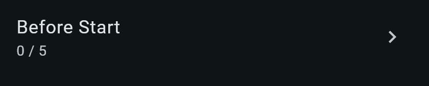

### `sw_item`

`sw_item:Label|Result[:condition]`

*App support: supported, with auto-check.*

A check item the pilot ticks: a label, the expected result, and an optional dataref condition. The condition is the text after the dataref colon. It lets the app auto-check the item one step ahead of the pilot. (I2 to I4, W1)

Example, with a condition (from the local PC-12 checklist, not in the repository):

```
sw_item:Parking Brake|SET:sim/flightmodel/controls/parkbrake:1
```

Example, with no condition (from the local PC-12 checklist, not in the repository):

```
sw_item:Flight Control Lock|REMOVED
```

In the app: one row with a tick box. "Parking Brake" is at the left and "SET" is right-justified. The dataref text (`sim/flightmodel/controls/parkbrake:1`) is never shown. A row with a condition can be auto-checked when it is the next item and the sim agrees, and it then shows an auto mark. "Flight Control Lock" has no condition, so it is manual only. When ticked, the circle becomes a filled green check mark and the row is highlighted.

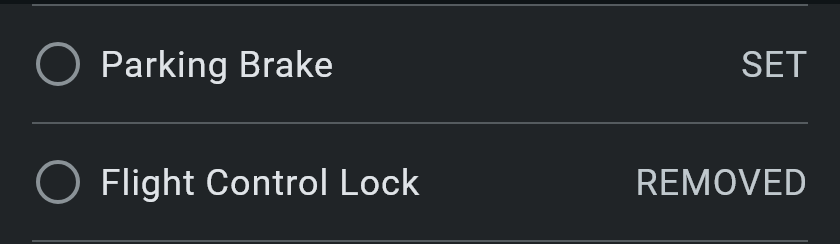

The same rows after tapping the circle of "Parking Brake":

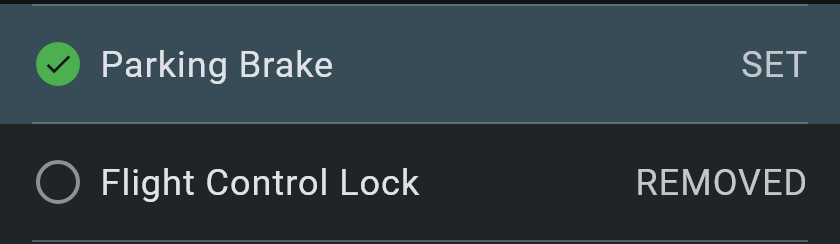

### `sw_item_c`

`sw_item_c:\colour\Label|Result[:condition]`

*App support: supported, with colours and auto-check.*

Same as `sw_item`, with colour markers in the label and result. (C1, C4)

Example (`testing/fixtures/lookalike_aircraft.txt`):

```
sw_item_c:\blue\Beacon\red\ light|ON:sim/cockpit2/switches/beacon_on:1
```

In the app: a check row reading "Beacon light" with "ON" at the right. "Beacon" is drawn in `blue` and " light" in `red`, using the colours defined by `sw_define_colour`. The backslash markers are not shown.

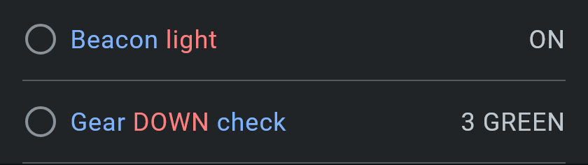

### `sw_iteminfo`

`sw_iteminfo:Label|Result[:condition]`

*App support: supported as a note.*

An information line. In this app it is a note (not tickable) with a label and a result. Its condition is parsed but not evaluated. (I7, W5)

Example (`testing/fixtures/lookalike_aircraft.txt`):

```
sw_iteminfo:Fuel quantity limit|3200 LBS
```

In the app: a row with no tick box, "Fuel quantity limit" at the left and "3200 LBS" at the right. It does not count towards completion.


### `sw_item_heading`

`sw_item_heading:Text[|justify]`

*App support: app extension (not in XChecklist). The real plugin warns about an unknown keyword, so use it only in files made for this app.*

A section heading: bold text on a darker band, no tick box, not checked or skipped. `justify` is `left`, `center` or `right` (any case; single letters are not accepted). With no `justify` it is centred. A colon is part of the text. (E1)

Example (from the local PC-12 checklist, not in the repository):

```
sw_item_heading:Empennage|center
```

In the app: a full-width darker band with "Empennage" in bold, centred.

### `sw_item_heading_c`

`sw_item_heading_c:\colour\Text[|j]`

*App support: app extension.*

Same as `sw_item_heading`, with colour markers.

### `sw_item_details`

`sw_item_details:Text`

*App support: app extension.*

A line of detail for the item above it: indented to start under that item's label, on a darker band, in a dimmer text colour. It has no tick box and no condition, and the whole value is the text (colons and bars included). Put it on the line after the `sw_item` it explains. (E3)

Example (from the local PC-12 checklist, not in the repository):

```
sw_item:Cargo (Combi Interior)|CHECK
sw_item_details:Check that cargo is located against retainer angles installed on seat rails.
```

In the app: the row "Cargo (Combi Interior)" with "CHECK" at the right, and under it a darker band with the detail text. (No picture yet: add the lines to the sample in `Documentation/Reference/checklist_docs/tools/make_checklist_images.dart` to make one.)

### `sw_item_details_c`

`sw_item_details_c:Text` with `\colour\` markers

*App support: app extension.*

Same as `sw_item_details`, with colour markers.

### `sw_itemvoid`

`sw_itemvoid:Text[|Text2]`

*App support: supported.*

A note or heading with no tick box. Text before the first `|` is the label and text after it is the result. Colons are not special. (N1)

Example (`testing/fixtures/lookalike_aircraft.txt`):

```
sw_itemvoid:---------- OVERHEAD PANEL ----------
```

In the app: a row with no tick box showing the text "---------- OVERHEAD PANEL ----------", used as a section heading.

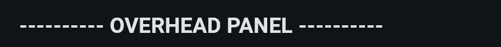

### `sw_itemvoid_c`

`sw_itemvoid_c:\colour\Text[|Text2]`

*App support: supported, with colours.*

Same as `sw_itemvoid`, with colour markers.

Example (`testing/fixtures/lookalike_aircraft.txt`):

```
sw_itemvoid_c:\white\          EXAMPLE TWIN TURBOPROP
```

In the app: a note row reading "EXAMPLE TWIN TURBOPROP" in the colour `white`. The marker is not shown, and the padding spaces are trimmed.


### `sw_remark`

`sw_remark:Text`

*App support: supported.*

A note whose label is the whole value. (N2)

Example (`testing/fixtures/lookalike_aircraft.txt`):

```
sw_remark:Complete each checklist from top to bottom.
```

In the app: a note row with no tick box reading "Complete each checklist from top to bottom."


### `sw_define_colour`

`sw_define_colour:name:r,g,b`

*App support: supported.*

Defines a named colour for the file. The three values are 0 to 1, and out-of-range values are clamped with a warning. The first definition of a name wins. (C5)

Example (`testing/fixtures/lookalike_aircraft.txt`):

```
sw_define_colour:amber:1.0,0.75,0.0
```

In the app: no row is shown. The name `amber` can then be used in a marker such as `\amber\`, and text after it is drawn in that colour.

### `sw_continue`

`sw_continue`, `sw_continue:Name` or `sw_continue:Name:condition`

*App support: supported, with conditional Continue.*

Links to the next checklist: bare means the next one in the file, and `Name` means the checklist with that name. Several links can follow each other and are tried in file order. The first link with no condition, or whose condition holds, is offered as the one **Continue** button. Conditions on `sw_continue` cannot use change or crossing operators. An unknown target or a misplaced bare link is dropped with a warning. (F1 to F5, J1 to J6)

Example, at the end of a checklist (`testing/fixtures/conditions/continue.txt`):

```
sw_continue:Second:fx/c/yes:1
sw_continue:Third:fx/c/yes:1
```

In the app: no row is shown. When the last item of the checklist is done, the detail screen shows one **Continue** button for the first link whose condition holds, here "Second" if `fx/c/yes` is 1. A link with no condition is always valid, so put it last. If no link matches there is no Continue button.

### `sw_show`

`sw_show:condition`

*App support: **not supported** (D-70).*

In X-Plane's XChecklist plugin it pops up a checklist when its condition holds. The app ignores the line like a comment, with no warning and no effect.

Example (`testing/fixtures/lookalike_aircraft.txt`):

```
sw_show:sim/cockpit2/electrical/battery_on[0]:1
```

In the app: nothing. The checklist behaves as if the line were not there, and it is never opened or suggested by itself.

### `sw_rcolsize`

`sw_rcolsize:...`

*App support: accepted and ignored with no warning (K3).*

Result column width in X-Plane's XChecklist window.

Example (`testing/fixtures/lookalike_aircraft.txt`):

```
sw_rcolsize:60
```

In the app: nothing. The app lays out the result column itself.

### Any other `sw_*`

*App support: warning `unknown keyword`, line skipped, checklist stays open (K4).*

A typo or unknown keyword.

Example: `ssw_item_c` is a typo that was found in two real aircraft checklist files during development (K4). It is not in the PC-12 checklist.

In the app: the line is skipped, a warning `Line N: unknown keyword "ssw_item_c"` is recorded, and the following lines still belong to the open checklist.

## 2. Line prefixes and markers (placeholders)

### `#` at the start of a line

Comment, on any line. It is skipped with no warning. A `#` inside text is ordinary text. `//` and `;` are not comments. (T6 to T8)

Example (from the local PC-12 checklist, not in the repository):

```
# Pilatus PC-12 (Legacy) Normal Operations Checklist
```

In the app: nothing is shown.

### `@` directly before a keyword

Means "do not speak" in X-Plane. It is removed and has no effect here. (T9)

Example (the grammar notes 4 such lines in 2 surveyed files; this one is made up to show the form):

```
@sw_item:Parking brake|SET
```

In the app: shown as the normal row "Parking brake" with "SET".

### `\name\`, in a label or result

Colour marker. The text after it takes the colour `name` (a `sw_define_colour` name or a built-in one) until the next marker. The marker itself is not shown. An undefined name warns and uses the default colour. (C1, C2, C6)

Example (`testing/fixtures/lookalike_aircraft.txt`):

```
sw_item_c:\blue\Beacon\red\ light|ON:sim/cockpit2/switches/beacon_on:1
```

In the app: "Beacon" is blue and " light" is red, on one row with "ON" at the right.


### `\\`, in a label or result

Colour return marker. It pops the colour stack, so the text goes back to the colour before the last marker (or the default). It is not an escaped backslash. (C3)

Example (made up from the grammar's own case, C3):

```
sw_item_c:\blue\Gear \red\DOWN\\ check|3 GREEN
```

In the app: "Gear " is blue, "DOWN" is red, and " check" goes back to blue.


### `|`, in `sw_item` and `sw_itemvoid`

Separator between label and result. A `|` after the first `:` belongs to a condition, not the label.

Example (from the local PC-12 checklist, not in the repository, a `|` in the condition of the Power Control Lever line, which is a range):

```
sw_item:Power Control Lever|IDLE:sim/cockpit2/engine/actuators/hardware_throttle_ratio[0]:0.035|0.055
```

In the app: the label is "Power Control Lever" and the result is "IDLE". The second `|` is the range 0.035 to 0.055 and is not shown.

### `:`, in `sw_item` and `sw_continue`

Starts the dataref condition. Everything after it is parsed as a condition and never shown.

Example (from the local PC-12 checklist, not in the repository):

```
sw_item:Landing Gear Handle|DOWN:sim/cockpit2/controls/gear_handle_down:1
```

In the app: a row "Landing Gear Handle" with "DOWN" at the right. The part after the second colon is the condition, `gear_handle_down` equal to 1.

## 3. Condition syntax (after the dataref colon)

Used on `sw_item`, `sw_item_c`, `sw_iteminfo` and `sw_continue`. An item whose condition cannot be parsed stays manual and the document gets the warning `condition not supported: <reason>` (M2).

Every condition is never shown in the app. It only decides whether the item can be auto-checked, or whether a Continue link is offered.

### `name:V`, `name:=V`, `name:==V`

Equal, within 1e-6. (O1)

Example (from the local PC-12 checklist, not in the repository):

```
sw_item:Landing Gear Handle|DOWN:sim/cockpit2/controls/gear_handle_down:1
```

In the app: the item is met when `gear_handle_down` is 1.

### `name:!V`, `name:!=V`

Not equal. There is no logical NOT. (O2, X4)

Example (made up; the form is in the grammar):

```
sw_item:Parking Brake|RELEASED:sim/flightmodel/controls/parkbrake:!1
```

In the app: the item is met when `parkbrake` is anything but 1.

### `name:<V`, `name:>V`, `name:<=V`, `name:>=V`

Comparison with no tolerance. (O3)

Example (from the local PC-12 checklist, not in the repository):

```
sw_item:EFIS Switch|NORM:thranda/Switch[31]:<0.5
```

In the app: the item is met when `Switch[31]` is below 0.5.

### `name:A|B`

In range, `A <= x <= B`, ends included. (O4)

Example (from the local PC-12 checklist, not in the repository):

```
sw_item:Flaps Lever|15 DEG:sim/cockpit2/controls/flap_handle_request_ratio:0.333|0.334
```

In the app: the item is met when the flap handle is between 0.333 and 0.334.

### `name:A:B`

Crossing. Rising when `A < B`, falling when `A >= B`. Needs memory. Never true in a `sw_continue`. (O5, J3)

Example (made up; the form is in the grammar, here as the condition of an `sw_show`):

```
(sim/flightmodel/position/groundspeed:10:1)
```

In the app: here A is 10 and B is 1, so it is falling. It arms when the groundspeed is at or above 10 and is met when it falls to 1 or below. It is not met if the speed never goes above 10.

### `name:+>n`, `name:-<n`, `name:><n`

Change from a baseline taken at the first evaluation: rise by more than n, fall by more than n, or move by more than n either way. Never true in a `sw_continue`. (O6, J3)

Example (made up; the form is in the grammar):

```
sw_item:Altitude|CLIMBING:sim/cockpit2/gauges/indicators/altitude_ft_pilot:+>100
```

In the app: the item is met once the altitude is more than 100 above the value first read when the item became the next one.

### `a && b`, `a || b`, `( ... )`

And, or, and nesting. `&&` binds tighter than `||`. (X1, X2)

Example (from the local PC-12 checklist, not in the repository):

```
sw_item:AHRS 1 & 2 Switches|SLAVE:(sim/cockpit/gyros/gyr_free_slaved[0]:1)&&(sim/cockpit/gyros/gyr_free_slaved[1]:1)
```

In the app: the item is met only when both gyros are slaved.

### `{name}` or `{name[n]}`

Placeholder for another dataref's current value, for example `x:>{y}`. (V3)

Example (made up; the form is in the grammar):

```
sw_item:Fuel balance|CHECK:sim/flightmodel/weight/m_fuel[0]:>{sim/flightmodel/weight/m_fuel[1]}
```

In the app: the item is met when the first tank's value is greater than the second tank's current value.

### `name[n]`

Element n of an array dataref. (N1, N2)

Example (from the local PC-12 checklist, not in the repository):

```
sw_item:Oxygen Lever|ON:thranda/anim/Oxygen:1
sw_item:EFIS Switch|NORM:thranda/Switch[31]:<0.5
```

In the app: `Switch[31]` reads element 31 of the array. An index past the end is "unknown", so the item stays manual.

### `+ - * / **` and `( )`

Arithmetic on the right side. `**` is power. (V2)

Example (made up; the form is in the grammar):

```
sw_item:Torque|SET:sim/cockpit2/engine/indicators/torque_n_mtr[0]:>=(2+3)*100
```

In the app: the right side works out to 500, and the item is met when the torque is 500 or more.

### `round(x)`, `step(x)`, `closer_than(a,b,eps)`

The only functions. (V4)

Example (made up; the form is in the grammar):

```
sw_item:Heading|SET:sim/cockpit/autopilot/heading:round({sim/cockpit2/gauges/indicators/heading_electric_deg_mag_pilot})
```

In the app: the item is met when the heading bug equals the heading rounded to a whole number. Any other function name makes the condition unsupported, a warning is recorded, and the item stays manual.

### `(int)`, `(float)`, `(double)`

Casts. (V5)

Example (made up; the form is in the grammar):

```
sw_item:Flaps|SET:sim/flightmodel/controls/flaprqst:(int)1
```

In the app: the right side is read as the whole number 1.

### Unknown values

A missing dataref, an index past the end, no value yet or a stale stream gives `unknown`. An unknown condition is never met and never ticks an item or opens a link (N4). X-Plane's own plugin reads a missing dataref as 0 instead.

## 4. How auto-check behaves (D-71)

- The app evaluates only the **pointer item**, the first unchecked check item. It does not tick every item whose condition holds.
- The pointer follows the pilot's manual ticks, forward or back. Auto-check never overrides a manual tick, and a manual tick wins.
- A manual tick of an item the dataref says is false opens a red acknowledge dialog and leaves a red mark.
- Auto-check works one way, from unchecked to checked. An item that goes back out of its condition is not unchecked.

## 5. The sample used for the pictures

The pictures were made by loading this text into the app's real checklist screen (a Flutter widget test), in the dark theme unless named otherwise. The colour values for `blue` and `red` are `0.1,0.3,0.8` and `0.75,0.0,0.0` for the light theme, and `0.5,0.7,1.0` and `1.0,0.5,0.5` for the dark theme.

```
sw_define_colour:blue:0.1,0.3,0.8
sw_define_colour:red:0.75,0.0,0.0
sw_define_colour:white:0.9,0.9,0.9
sw_checklist:Before Start:Before Start
sw_remark:Complete each checklist from top to bottom.
sw_itemvoid:---------- OVERHEAD PANEL ----------
sw_itemvoid_c:\blue\EXAMPLE TWIN TURBOPROP
sw_item:Parking Brake|SET:sim/flightmodel/controls/parkbrake:1
sw_item:Flight Control Lock|REMOVED
sw_item_c:\blue\Beacon\red\ light|ON:sim/cockpit2/switches/beacon_on:1
sw_item_c:\blue\Gear \red\DOWN\\ check|3 GREEN
sw_iteminfo:Fuel quantity limit|3200 LBS
sw_item:Landing Gear Handle|DOWN:sim/cockpit2/controls/gear_handle_down:1
```

Whole screen, dark theme, nothing ticked, then with "Parking Brake" ticked:

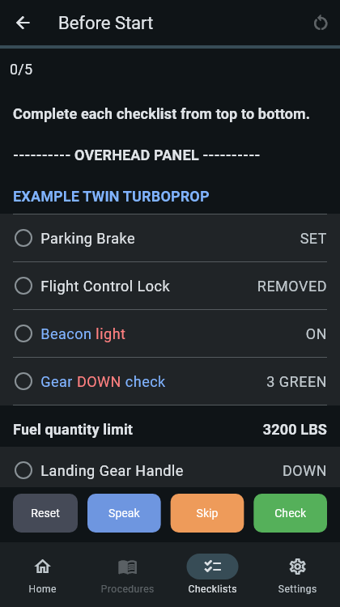
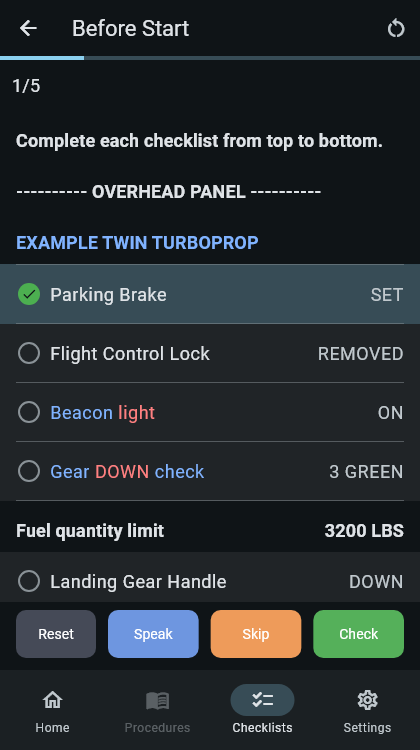

Light theme:

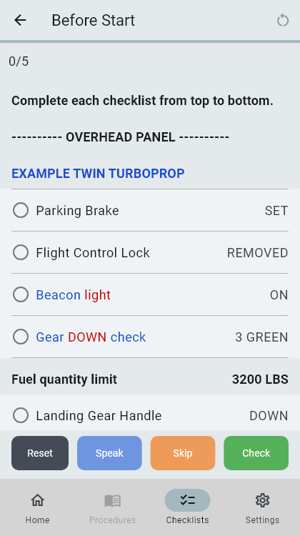
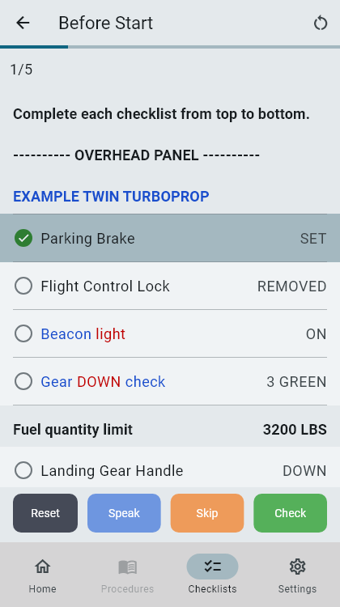

The checklist list screen, dark and light:

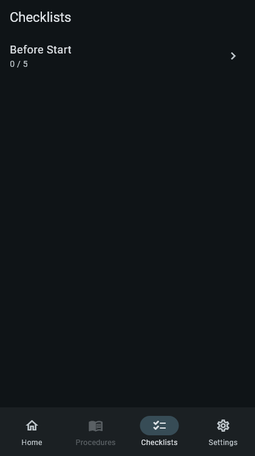
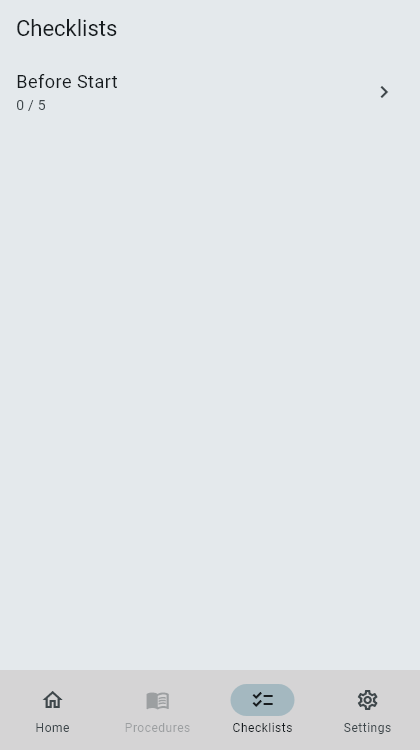

Not pictured, because they need a live sim or a connected app: the auto-check mark, the red acknowledge dialog and the Continue button. Those are described in the text above but have not been rendered here.
